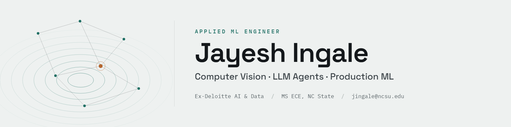

<h2>Hey there! I'm Jayesh</h2>

### 👨🏻‍💻 &nbsp;About Me

I'm an early-career AI/ML engineer who enjoys building AI systems that hold up in production.

🌱 &nbsp;Currently an **Applied ML Engineer** at [Precision Sustainable Ag](https://www.precisionsustainableag.org/), working with our team across research and production on computer vision and depth models.\
🏢 &nbsp;Previously a **Data Scientist** at [Deloitte – AI & Data](https://www.deloitte.com/in/en.html), where I was part of a team building a GenAI RAG assistant on AWS for an enterprise insurance client.\
🤖 &nbsp;Outside of work, I build production-grade **LLM agent systems** for fintech and legal, with a focus on guardrails, citation grounding, and evaluation.\
🎓 &nbsp;MS in Electrical & Computer Engineering, **NC State University**.\
🎯 &nbsp;Looking for **AI/ML Engineer** and **Forward Deployed Engineer** roles where I can own problems end to end, from the first customer conversation to a system in production.\
✉️ &nbsp;Always happy to chat. Reach me at **jingale@ncsu.edu**.

### 🚀 &nbsp;Featured Projects

| Project | What it does | Stack |
|---|---|---|
| [**Self-Evolving Topic Ontology for Earnings Calls**](https://github.com/ijayeshh/REPO_NAME) | Multi-agent system that builds a self-evolving topic ontology from earnings call transcripts, with a citation-enforcing verification loop and an MCP server | LangGraph · MCP · ChromaDB · FastAPI · TypeScript |
| [**Self-Hosted AI Banking Copilot**](https://github.com/ijayeshh/REPO_NAME) | On-premise copilot for querying customer portfolios, with layered guardrails: PII redaction, prompt-injection detection, SQL validation, and audit logging | Llama 3.2 · LangGraph · PostgreSQL/pgvector · Presidio |
| [**Hybrid Retrieval + NLI Verification for Legal Contracts**](https://github.com/ijayeshh/REPO_NAME) | Citation-grounded QA over 510 contracts, with hybrid retrieval, reranking, and an NLI model that checks every claim against its source | FAISS · LangGraph · FastAPI · promptfoo |
| [**LLM Alignment with DPO**](https://github.com/ijayeshh/REPO_NAME) | Aligned Qwen2.5-7B-Instruct with DPO and LoRA, evaluated with LLM-as-a-judge | Unsloth · PEFT · LoRA |
| [**Self-Supervised Contrastive Learning**](https://github.com/ijayeshh/REPO_NAME) | SimCLR and Barlow Twins on STL10, benchmarked against a supervised baseline | PyTorch |

### 🛠 &nbsp;Tech Stack

**Languages & Backend**\
&nbsp;
&nbsp;
&nbsp;
&nbsp;
&nbsp;
&nbsp;
&nbsp;
&nbsp;

**GenAI & LLMs**\
&nbsp;
&nbsp;
&nbsp;
&nbsp;
&nbsp;
&nbsp;
&nbsp;
&nbsp;
&nbsp;
&nbsp;
&nbsp;
&nbsp;

**ML & Computer Vision**\
&nbsp;
&nbsp;
&nbsp;
&nbsp;
&nbsp;
&nbsp;
&nbsp;

**MLOps & Cloud**\
&nbsp;
&nbsp;
&nbsp;
&nbsp;
&nbsp;
&nbsp;
&nbsp;
&nbsp;

### 🤝🏻 &nbsp;Connect with Me

